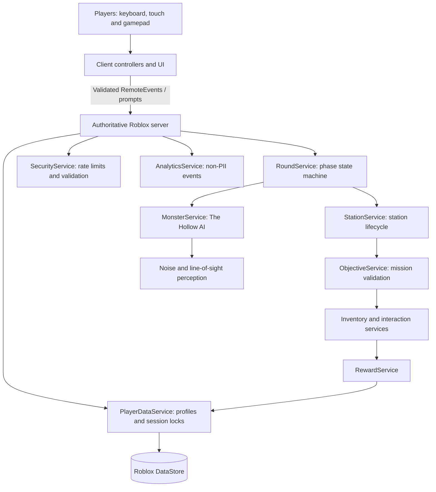

# NIGHTLINE: LAST TRAIN

> **Every stop is a risk. Every return is a reward.**

NIGHTLINE is a 1–6 player cooperative survival adventure for Roblox. A crew rides the last train through an abandoned city, explores dangerous stations for resources and mission objectives, evades a sound-hunting creature known as The Hollow, and must extract before the train departs.


## Current release status

The development-progress document explicitly says the current candidate is **not production-ready**. It reports automated CI and regression tests, but the release-readiness gate remains blocked because current-candidate Studio, multiplayer, persistence, and device evidence must be reviewed against the exact candidate commit. Historical test evidence is not release sign-off.

See [Development Progress](docs/DEVELOPMENT_PROGRESS.md) and [Testing & Verification](docs/TESTING.md).

## Why it matters

The game loop is built around co-op coordination and server authority: teams vote on destinations, split objectives, manage noise and threat, and decide when to abandon optional loot to make extraction.

## Gameplay and authority architecture



The client presents input and feedback. The server is responsible for round state, mission completion, monster damage, rewards, inventory, and persistence.

## Core gameplay systems

- Train hub, boarding, destination voting, travel, exploration, extraction, return, and results phases.
- Station generation and objective templates: Restore Power, Recover Cargo, and Repair Signal.
- The Hollow's patrol, hearing, line-of-sight, search, and attack behavior.
- Equipment and inventory, scrap rewards, artifacts, train upgrades, and profile persistence.
- Touch/gamepad-aware controls, camera transitions, audio layers, and station atmosphere.
- Remote validation, rate limiting, distance checks, and server-side ownership of gameplay state.

## Development environment

Roblox Studio and strict Luau · Rojo 7.7.1 · Selene 0.32.0 · Git

## Quick setup

Live sync with Roblox Studio:

```powershell
.\bin\rojo.exe serve
```

Build a place file:

```powershell
.\bin\rojo.exe build -o Nightline.rbxl
```

Run static analysis:

```powershell
.\bin\selene.exe src
```

## Verification

The development-progress document currently reports **34/34 automated regression suites passing** and a clean Selene result. The testing document lists project-build, static-analysis, gameplay, server-authority, persistence, security, and UI/device test cases.

These are repository-maintained verification records, not an independently reproduced benchmark. Review the exact tested commit and staging evidence before treating a release candidate as ready.

[Browse the source](https://github.com/MokuLakshithReddy/nightline-last-train)
